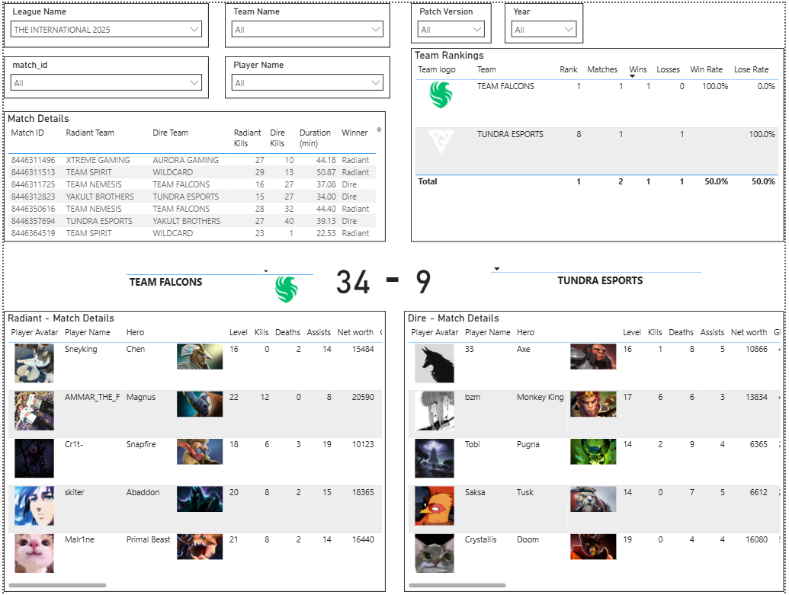
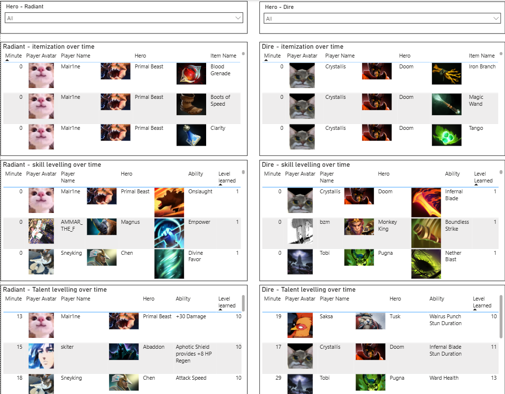
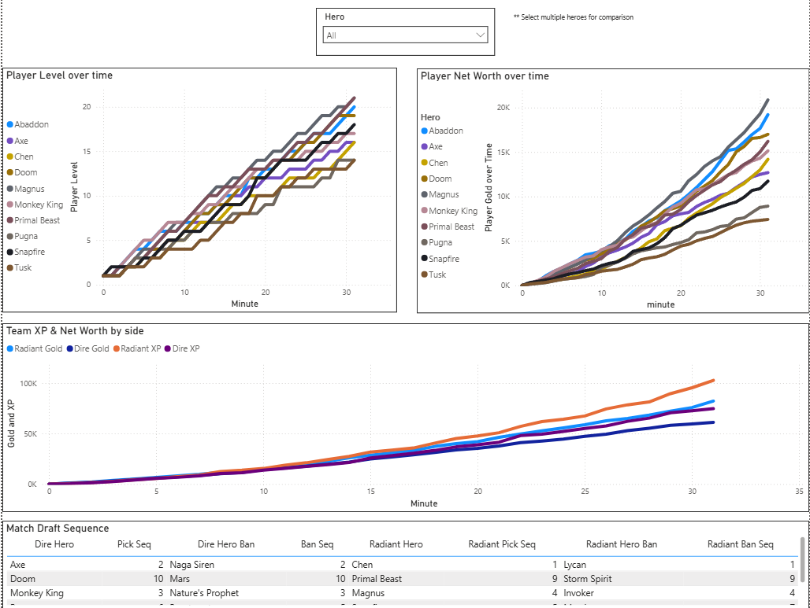

# DOTA 2 Data Pipeline

An end-to-end data pipeline that pulls Dota 2 match data from the
[OpenDota API](https://docs.opendota.com/) and turns it into a Power BI
dashboard. It covers the full journey: ingest -> store -> model -> orchestrate
-> test -> present.

**This is a portfolio project.** It demonstrates the whole data path, not just
one step.

## The flow

```text
OpenDota API
    |  throttled, quota-aware HTTP (60/min, 3,000/day)
    v
raw JSON files (data/)
    |  scripts/load_bronze.py (idempotent upsert)
    v
PostgreSQL (Docker, postgres:16)
    |  bronze (raw jsonb) -> silver -> gold (dbt)
    |
    |  orchestrated by Dagster AND Airflow
    v
Power BI report (PBIP / DirectQuery)
```

It is reproducible: `git clone` + `docker compose up` runs against a committed
200-match sample, with no API re-scrape needed.

## Choose your dataset

| Dataset | Size | Use |
|---|---|---|
| `sample_data/` | 200 matches, 107 MB | CI and reproducibility |
| `demo_data/` | 1,500 matches, 634 MB | portfolio dashboard (recommended) |
| `data/` | 29k matches, 11.4 GB | full scrape archive (optional) |

For an entry-level portfolio, use the curated 1,500-match demo. It builds in
about 14 minutes on a 16 GB laptop and produces a 1 GB database. The full 29k
scrape is kept only as an archive. Loading all of it is not necessary for the
portfolio and is too heavy for a 6 GB Docker VM.

The 1,500-match `demo_data/` is generated from the local `data/` scrape. A fresh
clone only has the committed 200-match `sample_data/`; build that into `dota`
and switch the PBIP to `dota` if you do not have the full scrape.

## Tech stack and why

| Tool | Why it is used |
|---|---|
| OpenDota API | Free, real Dota 2 data with public docs |
| PostgreSQL (Docker) | Industry-standard, free, and expected by dbt + Power BI |
| dbt | Standard SQL transformation with tests, docs, and lineage |
| Dagster + Airflow | The two big orchestrators; both wrap one shared runner |
| Power BI (PBIP, DirectQuery) | Free, standard in business, source-controllable text format |
| GitHub Actions + ruff + sqlfluff + pytest | Free, standard CI for Python + SQL quality |

## Quick start

```powershell
python -m venv .venv
.\.venv\Scripts\python.exe -m pip install -r requirements.txt -r requirements-dev.txt

docker compose up -d                                              # Postgres

# Portfolio demo (recommended): creates dota_demo and points the PBIP at it.
.\.venv\Scripts\python.exe scripts\demo_pipeline.py --matches 1500 --switch-powerbi

# Small reproducible sample used by CI:
.\.venv\Scripts\python.exe scripts\run_pipeline.py --data-dir sample_data
```

Then open [`.pbip/dota pipeline.pbip`](.pbip/dota%20pipeline.pbip) in Power BI
Desktop (with Docker running) to see the report.

For day-to-day operations, double-click [`dota.cmd`](dota.cmd) or run:

```powershell
.\dota.cmd
```

It is an interactive menu for incremental load, full rebuild, scraping,
backups, tests, status, memory profiles, cleanup, Power BI, and Spark.

## What is done

- **Ingestion** - throttled, quota-aware, resumable OpenDota scrapers
- **Bronze** - raw `jsonb` + `loaded_at` and `source_fetched_at` stamps
- **Silver / Gold** - dbt: 33 gold models, star schema, referential integrity,
  freshness checks
- **Power BI** - multi-page report on the gold layer (DirectQuery)
- **Orchestration** - Dagster and Airflow over one shared runner
- **CI/CD** - lint + pytest + full `dbt build` on every push
- **Reproducibility** - committed 200-match sample + portable
  [`profiles.yml`](profiles.yml)
- **Migrations** - Alembic for the bronze schema
- **Memory safety** - runtime Postgres profiles; a full refresh temporarily
  raises work_mem/parallelism and always restores the safe default
- **Portfolio mode** - 1,500-match curated demo, 315 dbt build steps green,
  1 GB instead of 18 GB

## What is next

- Final visual pass over the report in Power BI Desktop against `dota_demo`.
- Extend the M0 Spark smoke test with a local Delta write.
- Finish the M0 Azure account and DP-203 Learn modules, then start M1 in
  `docs/cloud_azure_plan.md`.
- Optional: keep the 29k live database as an archive, but do not rebuild it on
  this laptop; use `demo_data/` for the portfolio.

## Memory profile

The Docker VM is capped at 6 GB on this 16 GB laptop. Postgres starts with
`shared_buffers=1GB` and `shm_size=1gb`; `scripts/db_profile.py` manages the
reloadable settings.

- Default: `work_mem=64MB`, 2 parallel workers, dbt threads 2.
- Full refresh: `work_mem=128MB`, 3 parallel workers, dbt threads 3, then the
  default is restored automatically.
- Use the demo database for full refreshes. Do not run a full 29k-match
  rebuild on this machine.

## Project layout

- [`data/`](data/) - scrapers + raw JSON (live scrape is gitignored)
- `demo_data/` - local 1,500-match portfolio subset (gitignored)
- [`scripts/`](scripts/) - pipeline runner, demo builder, memory profiles,
  cleanup, CLI
- [`spark/`](spark/) - M0/M1 PySpark scaffold
- [`transform/`](transform/) - dbt project (silver + gold models)
- [`orchestration/`](orchestration/) - Dagster + Airflow definitions
- [`.pbip/`](.pbip/) - Power BI report + semantic model (PBIP/TMDL)
- [`sample_data/`](sample_data/) - committed 200-match reproducible dataset
- [`db/`](db/) - init SQL + Alembic migrations
- [`tests/`](tests/) - pytest

## Screenshots







## Documentation

- **[`docs/data_model.md`](docs/data_model.md)** - silver and gold schema,
  table inventory, and relationships
- **[`docs/power_bi_setup.md`](docs/power_bi_setup.md)** - how the Power BI
  report and semantic model are wired
